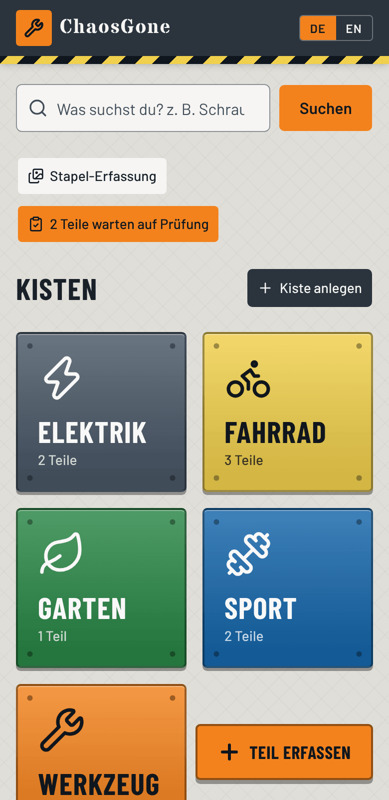
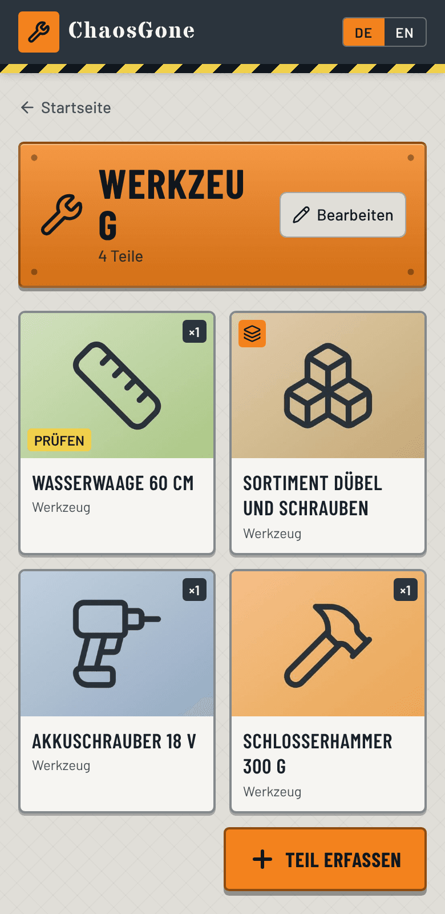
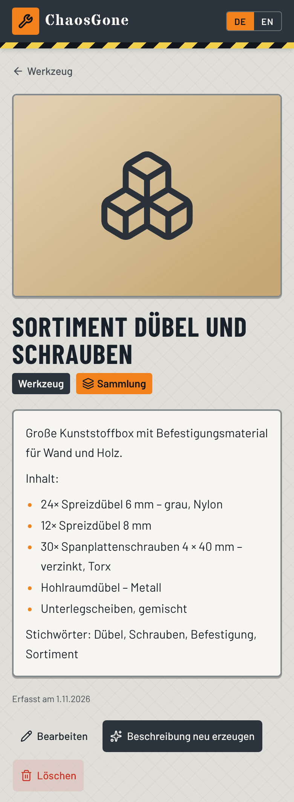
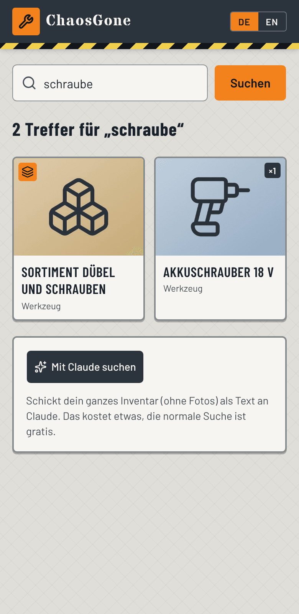

# ChaosGone

**Order in the basement.** Photograph the things in your boxes, let Claude describe them, and find them again
in seconds. A small self-hosted web app for a household: Next.js, SQLite and a folder of photos. No cloud
account, no login, runs happily on a Raspberry Pi.

<p>
  
  
  
  
</p>

The interface is in **German** (default) and **English**; the code and this documentation are in English.
A short German guide is at the [end of this file](#kurzanleitung-deutsch).

## Contents

- [What it does](#what-it-does)
- [Quick start](#quick-start)
- [User guide](#user-guide)
- [Configuration](#configuration)
- [Costs and choosing a model](#costs-and-choosing-a-model)
- [Deployment](#deployment) (pm2, Docker, HTTPS, reverse proxy)
- [Sharing links, favicons and the PWA](#sharing-links-favicons-and-the-pwa)
- [Data, backup and upgrades](#data-backup-and-upgrades)
- [How it works](#how-it-works)
- [API reference](#api-reference)
- [Troubleshooting](#troubleshooting)
- [Development](#development)
- [Kurzanleitung (Deutsch)](#kurzanleitung-deutsch)

## What it does

- **Boxes** (a handful: bicycle, tools, sports …) shown as large, touch-friendly tiles.
- **Items** with a box, a name, up to 10 photos, a quantity, an EAN/barcode (typed or scanned), your own notes
  and a long description that Claude writes from the photos.
- **Collections:** an item can be an assortment of different things (dowels and screws in one tin). Claude lists
  the different kinds, with size and count where it can tell, as a bullet list in the description.
- **Batch import:** pick a box and hundreds of photos; each photo becomes one item, identified by Claude. Review
  the results later in a one-by-one review queue.
- **Search:** one search bar over every field, fuzzy and German-aware (plurals, compound words such as
  *Schraubendreher*, typos, EAN). It is local and free. An optional **"Search with Claude"** button sends the
  inventory as JSON, **without photos**, for questions like "what can I use to fix a flat tyre?". It never runs
  unless you click it.
- **Regenerate a description** for an existing item, taking your own notes and a one-off hint into account.
  You see a proposal and decide whether to apply it.
- **Mobile first**, installable as a PWA, with a workshop look (steel, hazard stripes, safety orange).

## Quick start

Requirements: Node.js 22 (what it is developed and tested with) and an [Anthropic API key](https://console.anthropic.com/) for the Claude features
(everything else works without one).

```bash
git clone https://github.com/jzakotnik/chaosgone.git
cd chaosgone
npm install
cp .env.example .env.local      # then set ANTHROPIC_API_KEY
npm run dev                     # http://localhost:3000
```

On first start the app creates `data/chaosgone.db` and `data/photos/`. Create a box on the home screen, then tap
**Teil erfassen** (add item).

For a permanent installation see [Deployment](#deployment).

## User guide

### 1. Create boxes

On the home screen tap **Kiste anlegen** (add box). Give it a name, an icon and a colour. Boxes can be edited or
deleted later (deleting a box deletes its items and their photos, after a confirmation).

### 2. Add a single item

Tap **Teil erfassen** (add item):

1. Choose the box.
2. **Take a photo** (opens the phone camera) or pick photos **from the gallery**. Up to 10 per item; the first
   one is the cover.
3. Optionally write what you already know into **Your info about the item** (size, origin, condition). Claude
   treats this as reliable and will trust it over what it sees if the two disagree.
4. Tap **Mit Claude erkennen** (identify with Claude). Name, description and quantity are filled in. Edit
   anything you like.
5. Add a quantity if you know it (for screws) and an EAN/barcode, typed or with the **Scan** button.
6. **Save.**

### 3. Collections

Tick **Collection of several parts** when the photo shows an assortment. Claude then names the collection and
writes a list like this into the description:

```
Large plastic box with fixings for walls and wood.

Contents:
- 24× Expansion plug 6 mm – grey, nylon
- 12× Expansion plug 8 mm
- Chipboard screws – zinc-plated, Torx
```

The list is plain text. Edit it freely; it is searchable. Collections carry no quantity. Several photos from
different angles help with large assortments.

### 4. Batch import and review

Use this when you have photographed a lot of things and each photo is one item.

1. Home screen → **Stapel-Erfassung** (batch import).
2. Pick the box and select many photos (optionally tick that every photo is a collection).
3. **Start.** The photos are processed two at a time: upload, identification by Claude, saved immediately.
   Keep the page open until it finishes; everything already done stays saved if you close it.
4. If Claude fails for a photo (rate limit, network), the item is **still created** from the file name so the
   photo is not lost. Use **Retry failed** for uploads that failed, or **Regenerate description** later.
5. All batch items carry a yellow **Review** badge. The home screen shows how many are waiting; open the
   review list and press **Start review**. For each item check the text, edit if needed, then
   **Geprüft, weiter** (reviewed, next). Saving the edit form also counts as reviewed.

### 5. Search

- Type in the search bar on the home screen. Words may be partial, in other word forms or slightly misspelled.
  *Fahrrad schlauch*, *schraubendreger* and an EAN all work. Every word must match somewhere; the name counts
  most, then EAN and your notes, then the description.
- On the results page **Search with Claude** sends the whole inventory (text only) to Claude together with your
  question and returns the best matches with a one-sentence reason each. This costs a little per click and is
  off unless you press it.

### 6. Select, move and delete several items

Put things in the wrong box? On a box page, in the review list and in search results tap **Auswählen** (select),
then tap the items you want, or **Alle** (all). The bar at the bottom offers:

- **Verschieben** (move): choose the destination box and press the button. A toast with **Rückgängig** (undo)
  appears for a few seconds; undo also works when the items came from different boxes.
- **⋯ more actions:** *Als geprüft markieren* (mark as reviewed, for batch items) and *Löschen …* (delete). Deleting
  asks for confirmation and removes the items and their photos for good.

### 7. Regenerate a description

Open an item → **Beschreibung neu erzeugen**. Adjust your notes if you like, add a hint for this one run
("this is a hex key, not a Torx"), generate, edit the proposal and apply. Nothing is saved until you apply.

### 8. Barcode scanning

The **Scan** button uses the browser's camera and the `BarcodeDetector` API (Chrome/Edge on Android and
desktop). It needs **HTTPS or `localhost`**, because browsers only expose the camera on secure origins. Where
it is unavailable (for example iOS Safari) the app says so and you can type the number. Photo upload itself
works over plain `http://`.

### 9. PDF report

**Export PDF** on the home page creates an inventory report of all boxes, with a thumbnail, quantity, EAN, description and notes for every item. The button on a box page exports just that box. Every item card is measured before it is drawn, so items are never split or overlapped across pages. The report uses the current interface language.

### Language

The **DE | EN** switch in the header sets a cookie. German is the default. Descriptions generated by Claude are
written in the selected language.

## Configuration

Settings are environment variables. For `npm run dev` and `next start` put them in `.env.local`.

| Variable | Default | Purpose |
| --- | --- | --- |
| `ANTHROPIC_API_KEY` | – | Needed for photo recognition, batch import, regeneration and AI search. |
| `CLAUDE_MODEL` | `claude-opus-5-5` | Model used for all Claude calls. `claude-haiku-5-5` is much cheaper. |
| `DATA_DIR` | `./data` | Folder for `chaosgone.db` and `photos/` (including `photos/thumbs/`). |
| `SITE_URL` | from the request | Absolute base URL used in link previews; set it behind a proxy that does not forward the host. |
| `PORT` | `3000` | Port of `next start` and the standalone server (the pm2 file passes `-p 3500`). With Docker Compose it is the published host port. |
| `NEXT_OUTPUT` | – | `standalone` only inside the Docker build. Do not set it for pm2/`next start`. |

## Costs and choosing a model

Claude is called in exactly these places:

| Action | Calls | Input |
| --- | --- | --- |
| Identify with Claude (item form) | 1 | up to 4 photos, each downscaled to max. 1024 px, plus your notes |
| Batch import | 1 per photo | 1 photo each |
| Regenerate description | 1 | the item's photos (up to 4) plus notes |
| Search with Claude | 1 per click | the **entire inventory as text**, no photos |

The normal search, browsing and editing never call the API. Requests use low reasoning effort and a JSON schema,
so answers are short and well-formed.

The default model is the most capable one. For bulk work set `CLAUDE_MODEL=claude-haiku-5-5`; at the time of
writing it is roughly 40 times cheaper per token than Opus 5.5 ($0.10/$0.50 versus $4/$20 per million input/output
tokens; check the [current pricing](https://www.anthropic.com/pricing)). A sensible workflow: batch-import with
Haiku, then regenerate the few items it got wrong with a bigger model. The longer your inventory, the more the
AI search costs, because the whole list is sent each time.

## Deployment

### pm2 (Raspberry Pi or any Linux box)

`ecosystem.config.cjs` starts the app as `chaosgone` on port **3500** as a single process (SQLite is a
single-file database). Settings and the API key live in `.env.local`, which `next start` loads by itself.

First time:

```bash
cd ~/chaosgone
npm install
cp .env.example .env.local   # then set ANTHROPIC_API_KEY (and CLAUDE_MODEL if you like)
npm run build
pm2 start ecosystem.config.cjs
pm2 save                     # remember the process list across reboots
```

Update to a new version:

```bash
git pull && npm install && npm run build && pm2 restart chaosgone --update-env
```

The process file starts `next start -p 3500 -H 0.0.0.0`, i.e. **IPv4 only** (see
[Plain http on your LAN](#plain-http-on-your-lan) for why).

Useful: `pm2 logs chaosgone`, `pm2 restart chaosgone`, `pm2 stop chaosgone`. To start at boot run `pm2 startup`
once and execute the command it prints. If `npm run build` is killed on a small Pi (out of memory), add swap space
or build on another machine of the same architecture and copy the `.next` folder. Use a 64-bit OS so the prebuilt
native modules (`better-sqlite3`, `sharp`) install.

### Docker

```bash
ANTHROPIC_API_KEY=sk-ant-... docker compose up -d --build     # http://localhost:3000
PORT=3500 ANTHROPIC_API_KEY=sk-ant-... docker compose up -d   # publish on 3500 instead
```

Data lives in `./data` next to the compose file (mounted at `/data`). The image uses Next.js' standalone output
(`NEXT_OUTPUT=standalone` is set in the Dockerfile).

### Plain `http://` on your LAN

- **CORS needs no configuration.** UI and API come from the same origin (for example `http://raspihome:3500`),
  so uploads are ordinary same-origin requests. The API sends no CORS headers, so pages from other origins
  cannot use it.
- **What does not work over plain `http://` (except on `localhost`):** the barcode camera and full PWA
  installation, because browsers only allow the camera on secure origins. The scanner says so when you tap it.
  Photo upload is unaffected: *Take photo* and *From gallery* use the phone's own camera/file picker.
- **Host name:** the name (`raspihome`) must resolve on every device (router DNS, `raspihome.local`), otherwise
  use the IP address.
- **Chrome error "blocked by CORS policy: The request client is not a secure context and the resource is in
  more-private address space `local`":** this is Chrome's Private/Local Network Access check, not a CORS setting
  of the app. It happens when the host name has several addresses and one is a **public IPv6 address** (common
  with FRITZ!Box and other IPv6-enabled routers): Chrome loads the page over it, treats the page as "public", and
  then blocks the page's own requests to the private address. The app therefore listens on **IPv4 only**
  (`-H 0.0.0.0` in `ecosystem.config.cjs` and in `npm start`); without `-H`, Node binds to `::`. Check the
  addresses of your host with `dscacheutil -q host -a name raspihome` (macOS) or `hostname -I` (on the Pi). Using
  the IP address in the URL, or HTTPS, also avoids it.
- Use the production build. `next dev` additionally blocks requests from other hosts unless
  `allowedDevOrigins` is set.

### HTTPS (for the barcode scanner)

Put a reverse proxy in front, for example Caddy with an internal certificate:

```
chaos.home.lan {
  tls internal
  reverse_proxy localhost:3500
}
```

Trust Caddy's root certificate on your phone. Alternatives: Tailscale with HTTPS certificates, or on Android the
flag `chrome://flags/#unsafely-treat-insecure-origin-as-secure` for your own address. The app builds absolute
URLs from `X-Forwarded-Host` / `X-Forwarded-Proto`, so make sure the proxy forwards them (Caddy does).

### Security

There is **no login**. Anyone who can reach the port can read, change and delete everything and can spend your
API credit. Keep it on your LAN; if you expose it, put authentication in the reverse proxy. Listening on IPv4 only
also keeps the app off the host's public IPv6 address, which could otherwise be reachable from the internet if your
router allows incoming connections. Pages carry
`noindex, nofollow`, so search engines are asked to stay away.

## Sharing links, favicons and the PWA

- **Favicons and app icons:** a `favicon.ico` (16/32/48 px), an SVG icon, an Apple touch icon (full-bleed, 180 px)
  and PWA icons (192/512 px plus a maskable 512 px).
- **Link previews (Open Graph / Twitter cards):** every page has a title and description. The home page uses the
  ChaosGone card (`public/og-default.png`, 1200×630). **Item pages** use the item name, the start of the
  description (first paragraph, max. 160 characters) and **its first photo** as the preview image. Box pages show the box name and item count.
  Preview text follows the language cookie; crawlers get German by default.
- **Reachability:** preview crawlers must be able to open the URL. A LAN-only address works only for apps that
  fetch the preview on your own device; services that fetch it from their servers cannot reach it.
- **PWA:** installable ("Add to home screen") with shortcuts for *Teil erfassen*, *Stapel-Erfassung* and *Zu prüfen*.
  Full installation by Chrome needs HTTPS. There is no offline mode.

## Data, backup and upgrades

Everything lives in `DATA_DIR` (default `./data`):

```
data/
├── chaosgone.db         SQLite (WAL mode: also copies the -wal and -shm files while the app runs)
└── photos/
    ├── <uuid>.jpg        photo, max. 1600 px
    └── thumbs/<uuid>.jpg 480 px square thumbnail
```

- **Backup:** stop the app (`pm2 stop chaosgone`) and copy the whole folder, or use
  `sqlite3 data/chaosgone.db ".backup backup.db"` for the database while it runs, plus a copy of `photos/`.
- **Restore:** put the folder back and start the app.
- **Upgrades:** `git pull && npm install && npm run build` and restart. New columns are added to an existing
  database automatically on start; there are no manual migrations.
- Photos that were uploaded but never attached to an item are removed after 24 hours.

## How it works

**Stack:** Next.js (App Router, TypeScript), Tailwind CSS and shadcn/ui, `better-sqlite3`, `sharp`,
`heic-convert`, the Anthropic SDK.

**Data model** (`src/lib/db.ts`):

| Table | Columns |
| --- | --- |
| `boxes` | `id`, `name`, `icon`, `color`, `created_at` |
| `items` | `id`, `box_id`, `name`, `quantity`, `ean`, `description`, `notes`, `is_collection`, `needs_review`, `created_at`, `updated_at` |
| `item_photos` | `id`, `item_id`, `filename`, `position` |

**Photos** (`src/lib/photos.ts`): uploads are rotated according to EXIF, downscaled to 1600 px, stored as JPEG
with a 480 px thumbnail under random UUID names. iPhone **HEIC** is converted to JPEG first (pure JavaScript;
about 13 s for a 12 MP photo on a desktop CPU, slower on a Pi. Set the iPhone to *Settings → Camera → Formats →
Most Compatible* for big batches). Photos are served with long cache headers.

**Search** (`src/lib/search.ts`): text is normalised German-style (ä→ae, ß→ss, diacritics stripped), split into
words and lightly stemmed. Each query word is scored against every field (exact, prefix, substring for compound
words, small edit distance for typos), weighted by field (EAN and name highest). All words must match, otherwise
it falls back to any word. It runs in memory over the inventory, which is plenty fast for thousands of items.

**Claude** (`src/lib/claude.ts`): one `messages.create` call per action with a JSON schema as output format and
low effort. Photo requests send downscaled base64 JPEGs; the system prompt asks for the selected language and
never to invent sizes or counts. Failures are mapped to typed errors (`no_api_key`, `refused`, `bad_response`,
`api_error`) that the UI shows in plain language; manual entry always keeps working.

**Localisation:** dictionaries in `src/messages/de.json` and `en.json`, selected by the `locale` cookie. The type
checker fails the build if the two files do not have identical keys.

## API reference

All endpoints are JSON unless noted. Errors look like `{"error": "<code>", "message": "..."}`.

| Method and path | Purpose |
| --- | --- |
| `GET /api/boxes`, `POST /api/boxes` | List / create boxes |
| `GET/PATCH/DELETE /api/boxes/:id` | Read / update / delete a box (delete cascades) |
| `GET /api/items?box=<id>`, `GET /api/items?review=1` | List items of a box / items to review |
| `POST /api/items` | Create an item (`box_id`, `name`, optional `quantity`, `ean`, `description`, `notes`, `is_collection`, `needs_review`, `photos[]`) |
| `GET/PATCH/DELETE /api/items/:id` | Read / update / delete an item |
| `POST /api/items/bulk` | Bulk action on `item_ids[]`: `{action: "move", box_id}`, `{action: "mark_reviewed"}` or `{action: "delete"}` |
| `POST /api/items/:id/describe` | Propose a new description (`notes`, `hint`); saves nothing |
| `POST /api/photos` | Upload one photo as multipart field `file` (max. 25 MB), returns `{filename}` |
| `GET /api/photos/:name?thumb=1` | The photo or its thumbnail |
| `POST /api/classify` | Identify photos (`photos[]`, `hint`, `box_id`, `collection`) |
| `POST /api/batch` | Multipart `file`, `box_id`, `collection`: store, identify and create one flagged item |
| `GET /api/search?q=` | Local fuzzy search, free |
| `POST /api/search/ai` | `{q}`: ask Claude over the inventory (no photos) |
| `GET /api/status` | `{ai: boolean, model}` |

## Troubleshooting

| Symptom | Cause and fix |
| --- | --- |
| "Es ist kein ANTHROPIC_API_KEY eingerichtet" | Set the key in `.env.local` and restart (`pm2 restart chaosgone --update-env`). Manual entry works without it. |
| Scanner says the camera is blocked on `http://` | Browsers only allow the camera on HTTPS or `localhost`. See [HTTPS](#https-for-the-barcode-scanner). |
| "Foto konnte nicht verarbeitet werden" | The file is not a readable image. Check the server log (`pm2 logs chaosgone`). |
| Photos from an iPhone are slow | HEIC is converted on the server. Switch the camera to *Most Compatible* (JPEG). |
| Portrait photos are rotated wrongly | Rotation is read from the photo's metadata. Open an issue with the device and a sample file. |
| Page cannot be opened from the phone | The host name does not resolve on the phone (use the IP), the port is blocked by a firewall, or the app is not running (`pm2 list`). |
| Chrome: "blocked by CORS policy ... not a secure context ... more-private address space" (buttons do nothing, pages do not switch) | The host name resolves to a public IPv6 address as well. Update to the version that starts with `-H 0.0.0.0`, restart (`pm2 restart chaosgone --update-env`), or open the app by its IPv4 address. Details under [Plain http on your LAN](#plain-http-on-your-lan). |
| `next build` is killed | Out of memory on a small board: add swap or build elsewhere. |
| Batch import stops at "no API key" | Same as the first row; the batch stops at once instead of creating empty items. |
| Link preview shows no image or old text | The preview service caches results, or cannot reach a LAN address. |
| `EADDRINUSE` on start | Port in use. Pick another with `next start -p <port>` / change `args` in `ecosystem.config.cjs`. |

## Development

```bash
npm run dev          # development server with hot reload
npm run lint         # ESLint
npx tsc --noEmit     # type check, also verifies that de.json and en.json have the same keys
npm run build        # production build
```

There is no automated test suite yet. Changes so far were checked by type checking, linting, production builds
and browser runs against a local mock of the Claude API (the Anthropic SDK honours `ANTHROPIC_BASE_URL`, so
you can do the same without spending credit).

**Project layout**

```
src/app/                 pages, API routes (src/app/api/**), manifest, icons
src/components/          UI components (src/components/ui = shadcn)
src/lib/                 db, repo (data access), search, claude, photos, seo, i18n helpers
src/messages/            de.json, en.json
public/                  PWA icons, link-preview image
docs/screenshots/        images used in this README
website/                 static landing page for a public web server (see website/README.md)
ecosystem.config.cjs     pm2 process file
Dockerfile, docker-compose.yml
```

**Add a language:** copy `src/messages/en.json` to `src/messages/<code>.json` and translate it, add the code to
`LOCALES` in `src/lib/locales.ts`, and register the file in `MESSAGES` in `src/lib/messages.ts`. The type
checker tells you if a key is missing.

**UI components** come from [shadcn/ui](https://ui.shadcn.com/) (`npx shadcn@latest add <component>`); the
workshop theme lives in `src/app/globals.css`.

## Kurzanleitung (Deutsch)

1. **Kisten anlegen:** Startseite → *Kiste anlegen* (Name, Symbol, Farbe). Mehr als ein paar Kisten brauchst du nicht.
2. **Teil erfassen:** *Teil erfassen* → Kiste wählen → Foto aufnehmen oder aus der Galerie wählen → bei Bedarf
   eigene Infos eintragen → *Mit Claude erkennen* → prüfen → *Speichern*.
3. **Sammlung:** Haken bei *Sammlung aus mehreren Teilen* setzen, wenn ein Foto ein Sortiment zeigt (z. B.
   Dübel und Schrauben). Claude schreibt eine Liste der Elemente in die Beschreibung.
4. **Viele Fotos auf einmal:** *Stapel-Erfassung* → Kiste und Fotos wählen → *Starten*. Jedes Foto wird ein Teil.
   Danach über *2 Teile warten auf Prüfung* alles in Ruhe durchgehen: *Geprüft, weiter*.
5. **Suchen:** Suchleiste auf der Startseite. Teile von Wörtern, Mehrzahl und Tippfehler sind kein Problem. Die
   normale Suche kostet nichts. *Mit Claude suchen* schickt das Inventar (ohne Fotos) an Claude und kostet etwas.
6. **Beschreibung verbessern:** Teil öffnen → *Beschreibung neu erzeugen*. Deine eigenen Infos und ein Zusatzhinweis
   fließen mit ein. Gespeichert wird erst bei *Übernehmen*.
7. **Barcode scannen:** Funktioniert nur über HTTPS (oder `localhost`) in Chrome/Edge. Sonst die Nummer eintippen.
8. **Sicherung:** den Ordner `data/` kopieren (Datenbank und Fotos).
9. **Kosten sparen:** In `.env.local` `CLAUDE_MODEL=claude-haiku-5-5` setzen. Für Fotos auf dem iPhone
   *Einstellungen → Kamera → Formate → Maximale Kompatibilität* wählen, das geht deutlich schneller.

## License

[MIT](LICENSE) © 2026 Jure Zakotnik
